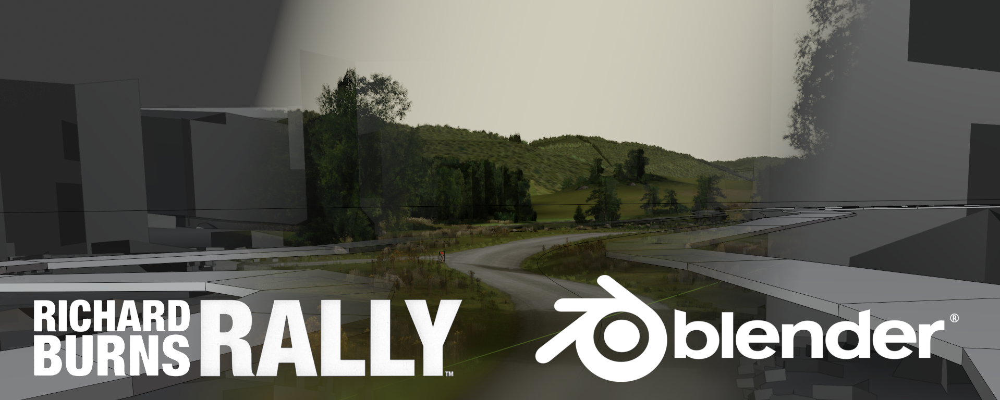

# RBR Track Exporter

This is a Blender extension for exporting tracks for Richard Burns Rally. The
ultimate goal is to understand and support every feature available in RBR, and
to supersede use of the custom export tool, Wallaby. Thank you to **Wally** for
the creation of that tool, without it RBR would have probably died by now.

Thanks to **WorkerBee** for his tireless reverse engineering efforts. Without
his help the development time would be several years longer.

Thanks to the many people who have tested the extension in the alpha stages,
and continue to give great feedback. In particular those who have been around
from the start: **Jan Kadeřábek**, **Joona Karimaa**, and **aesthetic_sofa**.

I hope you enjoy using the extension to create new stages for RBR.

-- <i>Tom Smalley</i>

## Using these docs

I would suggest skim reading all of the docs to get an idea of what's
available through the extension before diving in to actually use it. Otherwise, 
start with [Installation & Setup](./installation.md), and read through the
[RBR Glossary](./glossary.md) to understand the RBR specific terminology.
Then work through the [Quick Start](./quick-start.md) to build a minimal stage
end to end. After that, work through the rest of the docs as and when needed.

